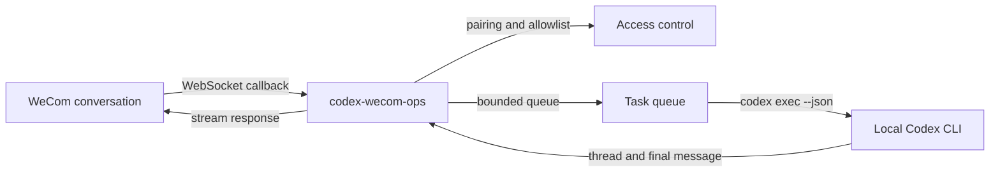

# codex-wecom-ops

[简体中文](README.md) | [English](README.en.md)

[](https://github.com/Mark-Tee/codex-wecom-ops/actions/workflows/ci.yml)
[](LICENSE)

A self-hosted bridge that connects a WeCom intelligent robot to the local Codex
CLI. Authorized users can mention the bot in a WeCom conversation, create a
Codex task, receive progress updates, and get the final response in the same
thread.

This is a security-focused public edition. It is not a hosted service and it is
not affiliated with Tencent, WeCom, or OpenAI.

## Why this exists

Most chat-to-agent bridges optimize for a quick demo. This project focuses on
the parts needed for daily local use:

- pairing before a user can run Codex
- per-conversation Codex thread continuity
- a bounded task queue and timeout
- streaming progress and final responses
- environment scrubbing before spawning Codex
- workspace-write sandboxing
- network access disabled by default
- no third-party runtime dependencies
- a localhost-only health endpoint

## Architecture



## Requirements

- Node.js 22 or newer
- Codex CLI installed and authenticated on the same machine
- A WeCom intelligent robot configured in API mode with long-connection
  delivery

## Quick start

1. Create the robot in WeCom and obtain its `BotID` and long-connection
   `Secret`.
2. Copy `config.example.json` to `config.json` and edit the workspace path.
3. Create a local `.env` file from `.env.example`.

   ```powershell
   Copy-Item .env.example .env
   ```

4. Set `WECOM_BOT_ID` and `WECOM_BOT_SECRET` in `.env`.
5. Start the bridge:

   ```powershell
   node --env-file=.env src/main.mjs
   ```

6. The first start writes a short-lived pairing code to
   `data/pairing-code.txt`.
7. Send the pairing command in WeCom:

   ```text
   /pair 123456
   ```

8. Mention the bot with a task:

   ```text
   @Codex explain the difference between OSPF LSA types 3 and 5
   ```

## Commands

| Command | Description |
|---|---|
| `/help` | Show the commands and usage boundaries |
| `/pair <code>` | Pair the current WeCom user |
| `/invite` | Generate a new pairing code for another operator |
| `/new` | Start a fresh Codex thread for the current conversation |
| `/status` | Show connection, queue, and task status |
| `/stop` | Stop the current task and clear queued work |

Every new command or behavior must be documented here and in `/help`.

## Bundled workflow skill

[`skills/ticket-to-report`](skills/ticket-to-report/SKILL.md) is a generic,
sanitized workflow for turning a text or image ticket into:

- a weekly-report row
- a shift-handover row
- a reviewable JSON draft specification

It contains no company names, employee names, real document IDs, or business
workbooks. The bridge itself does not write to external documents; a user must
install the skill and explicitly approve any write workflow.

## Security defaults

- `security.requirePairing` defaults to `true`.
- An empty `allowedUserIds` list does not mean "allow everyone"; it requires
  the first user to pair with a local one-time code.
- Codex runs with `workspace-write` and `approval_policy=never`.
- Codex sandbox network access is disabled unless explicitly enabled.
- User-level Codex config is ignored by default to avoid loading untrusted hooks
  and plugins. Set `codex.ignoreUserConfig=false` only after reviewing that
  configuration.
- The bridge removes `WECOM_BOT_SECRET`, `WECOM_BOT_ID`, `GITHUB_TOKEN`,
  `GH_TOKEN`, and `TENCENT_DOCS_TOKEN` from the Codex child environment.
- The child environment uses an allowlist instead of inheriting every variable.
  Additional variable names must be listed explicitly in `codex.inheritedEnv`.
- The health endpoint binds to `127.0.0.1` by default.

Read [SECURITY.md](SECURITY.md) before deploying this beyond a test server.

## Configuration

Secrets are read only from environment variables:

```text
WECOM_BOT_ID
WECOM_BOT_SECRET
```

Non-secret settings live in `config.json`:

- `codex.workdir`: the only Codex working root
- `codex.maxSeconds`: hard task timeout
- `codex.networkAccess`: sandbox network opt-in
- `codex.additionalWritableRoots`: additional explicit writable roots
- `security.allowedUserIds`: optional pre-approved WeCom user IDs
- `security.maxQueue`: maximum queued tasks
- `security.maxPromptChars`: maximum accepted prompt length
- `stateDir`: local state and pairing-code directory

## Scope

This version intentionally excludes:

- image and file ingestion
- web scraping shortcuts
- report-specific business schemas
- arbitrary shell endpoints
- public notification APIs
- cloud-hosted multi-tenant operation

Those are separate integrations and should not weaken the bridge's core trust
boundary.

## Development

```powershell
npm test
npm run check
```

The tests use only Node's built-in test runner.

## License

MIT. See [LICENSE](LICENSE).
