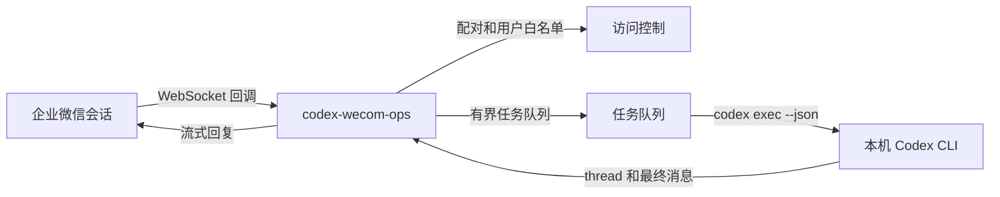

# codex-wecom-ops

[简体中文](README.md) | [English](README.en.md)

[](https://github.com/Mark-Tee/codex-wecom-ops/actions/workflows/ci.yml)
[](LICENSE)

这是一个自托管的企业微信智能机器人与本地 Codex CLI 桥接项目。经过授权的
用户可以在企业微信会话中 @ 机器人，让本机 Codex 执行任务，并在同一会话中
接收进度更新和最终结果。

本项目是注重安全边界的公开版本，不是托管服务，也不隶属于腾讯、企业微信或
OpenAI。

## 为什么做这个项目

很多聊天机器人与 Agent 的桥接项目只适合快速演示。本项目重点解决日常本地
使用时真正需要的能力：

- 用户完成本地配对后才允许执行 Codex
- 不同会话保持独立的 Codex thread 上下文
- 有数量上限的任务队列和硬性超时
- 流式推送进度与最终结果
- 启动 Codex 前清理并限制环境变量
- 使用 `workspace-write` 沙箱
- 默认关闭 Codex 沙箱网络访问
- 无第三方运行时依赖
- 仅监听本机的健康检查接口

## 架构



## 环境要求

- Node.js 22 或更高版本
- 同一台机器上已安装并完成登录的 Codex CLI
- 企业微信智能机器人，接收方式配置为 API 模式并启用长连接

## 快速开始

1. 在企业微信中创建智能机器人，获取 `BotID` 和长连接 `Secret`。
2. 将 `config.example.json` 复制为 `config.json`，并修改 Codex 工作目录。
3. 依据 `.env.example` 创建本地 `.env` 文件。

   ```powershell
   Copy-Item .env.example .env
   ```

4. 在 `.env` 中填写 `WECOM_BOT_ID` 和 `WECOM_BOT_SECRET`。
5. 启动桥接服务：

   ```powershell
   node --env-file=.env src/main.mjs
   ```

6. 首次启动会在 `data/pairing-code.txt` 写入短期有效的配对码。
7. 在企业微信中发送配对命令：

   ```text
   /pair 123456
   ```

8. 在群里 @ 机器人提交任务：

   ```text
   @Codex 解释 OSPF LSA 3 和 LSA 5 的区别
   ```

## 命令

| 命令 | 说明 |
|---|---|
| `/help` | 显示命令和使用边界 |
| `/pair <配对码>` | 配对当前企业微信用户 |
| `/invite` | 为本机生成新的配对码 |
| `/new` | 为当前会话创建新的 Codex thread |
| `/status` | 查看连接、队列和任务状态 |
| `/stop` | 停止当前任务并清空队列 |

新增任何命令或行为时，必须同时更新本文件和 `/help`。

## 内置工作流技能

[`skills/ticket-to-report`](skills/ticket-to-report/SKILL.md) 是一个脱敏后的通用
工作流，用于将文字或图片工单转换为：

- 周报任务行
- 交接班记录行
- 可复核的 JSON 草稿

该技能不包含公司名称、员工姓名、真实文档 ID 或业务工作簿。桥接服务本身
不会写入外部文档；用户需要自行安装技能，并明确确认所有写入操作。

## 默认安全策略

- `security.requirePairing` 默认为 `true`。
- `allowedUserIds` 为空不代表允许所有人，而是要求首个用户使用本机一次性
  配对码完成绑定。
- Codex 使用 `workspace-write` 和 `approval_policy=never` 运行。
- 除非显式开启，Codex 沙箱内的网络访问保持关闭。
- 默认忽略用户级 Codex 配置，避免加载未经审查的 hooks 和插件。只有在审查
  配置后才能设置 `codex.ignoreUserConfig=false`。
- 启动 Codex 子进程前，会从环境中移除 `WECOM_BOT_SECRET`、
  `WECOM_BOT_ID`、`GITHUB_TOKEN`、`GH_TOKEN` 和 `TENCENT_DOCS_TOKEN`。
- 子进程环境使用白名单继承，其他变量必须在 `codex.inheritedEnv` 中显式列出。
- 健康检查接口默认只绑定 `127.0.0.1`。

在非测试环境部署前，请阅读 [SECURITY.md](SECURITY.md)。

## 配置

凭据只从环境变量读取：

```text
WECOM_BOT_ID
WECOM_BOT_SECRET
```

非敏感配置位于 `config.json`：

- `codex.workdir`：Codex 唯一的工作根目录
- `codex.maxSeconds`：任务硬性超时
- `codex.networkAccess`：是否允许沙箱网络访问
- `codex.additionalWritableRoots`：显式附加的可写目录
- `codex.inheritedEnv`：显式允许传给 Codex 子进程的环境变量
- `security.allowedUserIds`：可选的预授权企业微信用户 ID
- `security.maxQueue`：最大排队任务数
- `security.maxPromptChars`：允许接收的最大提示词长度
- `stateDir`：本地状态与配对码目录

## 项目范围

当前版本有意不包含：

- 图片和文件接收
- 网络爬虫快捷入口
- 特定业务报表结构
- 任意 Shell 执行接口
- 公网通知 API
- 云端多租户服务

这些内容应作为独立集成处理，不应削弱桥接服务的核心信任边界。

## 开发

```powershell
npm test
npm run check
```

测试仅使用 Node.js 内置测试运行器。

## 许可证

MIT，详见 [LICENSE](LICENSE)。
